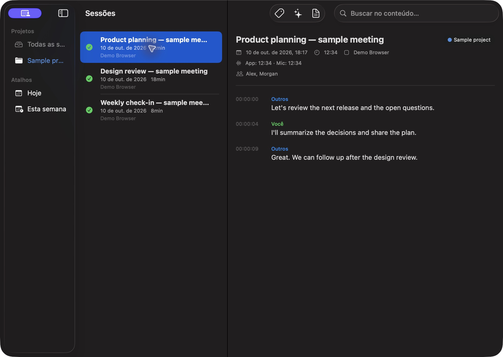
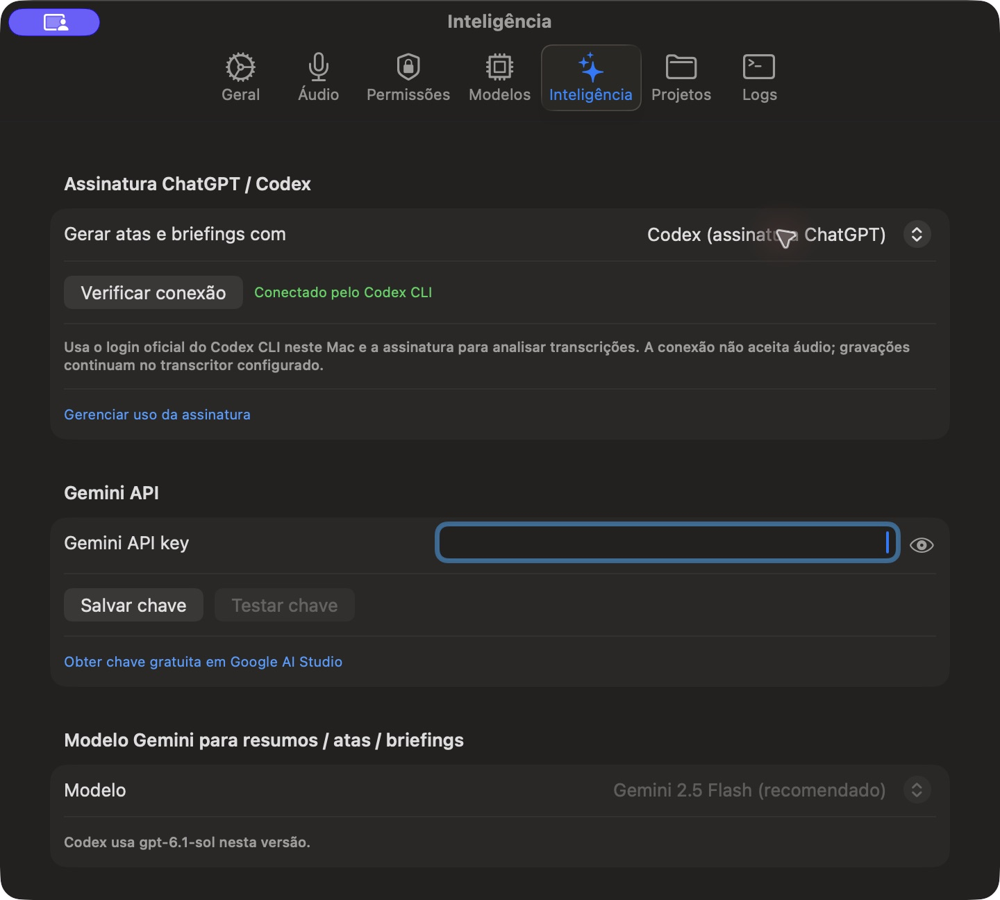
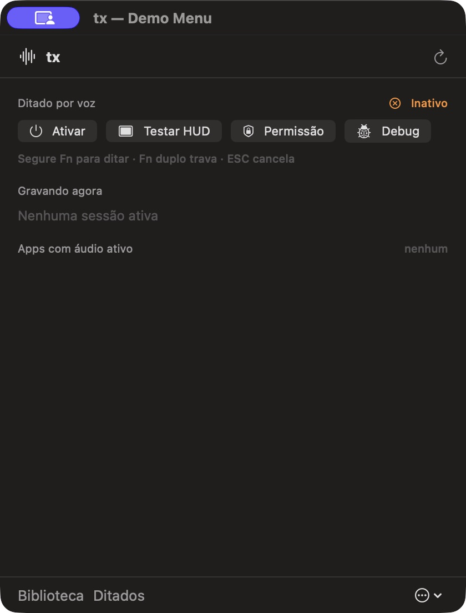

# tx — private meeting capture and voice dictation for macOS

[](https://github.com/distu/tx/actions/workflows/ci.yml)

**Capture the conversations you choose, turn speech into searchable text, and keep control of your audio.** tx is an open source, native macOS menu bar app built with SwiftUI, Core Audio process taps, WhisperKit, and SQLite.

It records each selected app process into separate application and microphone tracks, transcribes recordings, and organizes sessions in a searchable library. A global Fn shortcut also lets you dictate into the app you are using.

> **Early release.** tx is under active development. Review the [known limitations](#known-limitations) before relying on it for important meetings. Recording laws and consent requirements vary by location; you are responsible for obtaining any required consent.

## At a glance

| Feature | What it does |
| --- | --- |
| Process audio capture | Records audio from a selected macOS app process through Core Audio taps. Separate processes can be recorded independently. |
| Microphone track | Captures your voice in a separate track when tx can verify that the meeting microphone is enabled. An unknown mute state does not authorize microphone capture. |
| Meeting metadata | Detects supported meeting URLs and titles. An optional browser extension can supply Meet/Teams participants and mute state over localhost. |
| Transcription | Uses WhisperKit locally by default. Optional Gemini API transcription sends selected audio to Google. |
| Dictation | Hold Fn to speak, release to transcribe and paste; double tap Fn to lock; press Escape to cancel. |
| Searchable library | Stores sessions, segments, projects, and dictation history in a local SQLite database with full text search. |
| Meeting notes | Generates minutes and briefings from transcript text using a ChatGPT signed-in Codex CLI or an optional Gemini API key. |

### Screenshots

These screenshots use an isolated demonstration profile and contain no real meetings or account details.

| Session library | Settings | Menu bar |
| --- | --- | --- |
|  |  |  |

## Requirements

- macOS 26.1 or later on Apple Silicon.
- Xcode Command Line Tools or Xcode with Swift 6 to build from source.
- Microphone, Input Monitoring, Accessibility, and process audio capture permissions for the features you enable.
- Disk space for a Whisper model if you use local transcription. Model size depends on your selection.

There is no notarized release or installer yet. Build from source:

```bash
git clone https://github.com/distu/tx.git
cd tx
./scripts/build-app.sh release
open .build/tx.app
```

For repeat local builds, `./scripts/setup-local-cert.sh` creates and trusts a local development signing identity. Read the script first: it changes your login and System keychains and may request administrator access. You can build without it; ad hoc signing may cause macOS to request permissions again after a rebuild.

To install the built app manually, quit any running tx instance and copy `.build/tx.app` into `/Applications`. The build script does not install or launch the app for you.

## First run

1. Open tx from the menu bar and grant the macOS permissions needed for your chosen features.
2. In **Settings → Models**, choose and download a Whisper model for offline transcription.
3. Select an app with active audio to start a meeting recording. Check the microphone indicator before depending on your own voice track.
4. Open **Library** to inspect saved audio and transcription; use **Transcribe now** if a completed recording still has no transcript.
5. For dictation, enable it in the menu bar, then hold Fn while speaking and release it to paste the result.

On some Macs, the system's Globe/Fn shortcut intercepts Fn. Set **System Settings → Keyboard → Press 🌐 key to → Do Nothing** if tx does not receive the key.

## Local and optional cloud processing

| Path | Audio leaves your Mac? | Account needed? |
| --- | --- | --- |
| WhisperKit transcription | No | No |
| Gemini API transcription | Yes, audio is sent to Google | Gemini API key; separate API billing may apply |
| Codex CLI meeting notes | Transcript text is sent through the signed-in Codex CLI | ChatGPT/Codex CLI sign-in |
| Gemini API meeting notes | Transcript text is sent to Google | Gemini API key; separate API billing may apply |

**Codex CLI does not transcribe audio in this app.** It analyzes transcript text after the selected transcription engine has produced it. tx never reads or copies the CLI's stored sign-in token; it invokes the official CLI. The optional browser extension communicates only with `127.0.0.1:49200` on your Mac. See [Privacy and data flow](docs/PRIVACY.md).

## Known limitations

- Core Audio isolates **processes**, not browser tabs. Two meetings in one browser process can mix. Use separate browser instances or applications when you need isolation.
- Mute detection depends on the meeting app and available accessibility/extension signals. If tx cannot establish an enabled microphone state, it should leave the microphone track off. Check the live indicator and the saved track before relying on a recording.
- Meeting titles and participant names can be absent when a meeting is joined outside a supported URL or its UI does not expose those details.
- Browser integrations are evolving. Chrome/Arc Meet and web Teams have received hands-on development testing; Safari and native Teams need more validation.
- Local speech recognition can return incorrect words or text during silence. Inspect recordings and transcripts, especially for important decisions.
- Gemini audio requests currently have an 18 MB inline limit. Larger files use local transcription when available.
- There is no signed, notarized public binary. The app interface currently uses Portuguese; English UI localization is planned.

Please report reproducible problems through [GitHub Issues](https://github.com/distu/tx/issues), without attaching private recordings or transcripts.

## Development

```bash
swift build
swift test
./scripts/build-app.sh debug
```

The macOS app target is `TxApp`; the capture, transcription, database, and process logic live in `TxCore`. See [Architecture](docs/ARCHITECTURE.md), [Troubleshooting](docs/TROUBLESHOOTING.md), and the [contribution guide](CONTRIBUTING.md).

## Roadmap

- Improve mute state coverage and end to end tests across browsers and native meeting clients.
- Add English localization and accessible onboarding.
- Improve long audio handling and transcription quality checks.
- Add export formats and a notarized release workflow.
- Expand contributor friendly test fixtures without real user audio.

Roadmap items are plans, not release promises. Contributions and careful bug reports are welcome.

If tx helps you, consider starring the repository so other macOS users can find it. Questions belong in [Discussions](https://github.com/distu/tx/discussions); reproducible bugs belong in [Issues](https://github.com/distu/tx/issues).

## License

[MIT](LICENSE) © 2026 Wilher Distu. The third party dependencies retain their own licenses.
